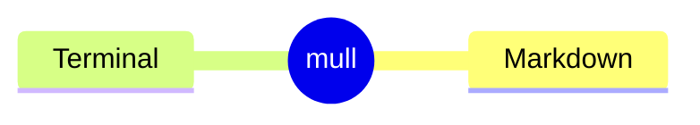

# Kitchen sink: every Markdown feature

An opening paragraph with **bold**, *italic*, ***both***, __bold__, _italic_, ~~strikethrough~~, `inline code` and ``code with a ` backtick``.
This line continues the same paragraph: a soft line break.
This one ends with two spaces, a hard line break.  
And this one ends with a backslash, also a hard break.\
The paragraph's last line, with a [link](https://example.com "Link title").

Setext heading, level 1
=======================

Setext heading, level 2
-----------------------

## ATX headings

### Level 3
#### Level 4
##### Level 5
###### Level 6
####### Seven hashes isn't a heading
#hashtag isn't a heading either
## Closing hashes ##
#
\# An escaped hash

## Inline features

Escapes: \*not italic\*, \_not italic\_, \`not code\`, \[not a link\]
Entities: &copy; &amp; &lt;tag&gt; &#35; &#x1F600;
Autolinks: <https://example.com>, <someone@example.com>, and a bare https://example.com (GFM)
Inline HTML: <kbd>Ctrl</kbd>+<kbd>C</kbd> and <span style="color: red">red text</span>
Image: 
References: [a full one][ref], [a collapsed one][] and [shortcut]
Footnotes: one[^1] and a named one[^note]
Emoji: a shortcode :tada: and a literal 🎉
Maths (extension): inline $E = mc^2$, and a block:

$$
\int_0^1 x^2 \, dx = \frac{1}{3}
$$

[ref]: https://example.com/ref "Reference title"
[a collapsed one]: https://example.com/collapsed
[shortcut]: https://example.com/shortcut

## Lists

- Tight bullet
- Another
  - Nested by two spaces
    - Nested by four
      - Nested by six
* Star bullet
+ Plus bullet

1. First
2. Second
   1. Nested ordered
   2. Again
10. Ten

3) Parenthesis style, starting at three
4) Four

- A loose item

  with a second paragraph.

- An item holding code:

  ```js
  console.log("inside a list");
  ```

- [ ] A task to do
- [x] A task done
  - [ ] A nested task

1. Ordered
   - bullet under it
     1. ordered under that

- Lazy continuation:
this line isn't indented but still belongs to the item.

## Block quotes

> A quote
> over two lines.
>
> > A nested quote.
>
> - A list in a quote
> 1. An ordered one
>
> ```
> Code in a quote
> ```

> [!NOTE]
> A GitHub alert.

> [!WARNING]
> Another kind.

## Code

```rust
// A comment
fn main() {
    println!("Hello, {}!", "world");
}
```

```bash
# A shell comment that looks like a heading
echo "- something that looks like a bullet"
ls -la
```

~~~python
# Tilde fences
def double(x):
    return x * 2
~~~

````markdown
```
A fence inside a longer fence
```
````

    An indented code block
    (four spaces)



## Tables

| Left | Centre | Right |
|:-----|:------:|------:|
| a    | b      | c     |
| `code` | **bold** | [link](https://example.com) |
| an escaped \| pipe | | an empty cell |

## Thematic breaks

---

***

___

- - -

## HTML blocks

<details>
<summary>Click to expand</summary>

Hidden **Markdown** content.

</details>

<!-- A comment, invisible when rendered -->

<div align="center">
  
</div>

## Definition lists (extension)

Term
: The term's definition

Another term
: A first definition
: A second definition

## Unicode and edge cases

漢字とかな, 한국어, Ελληνικά, עברית (right to left), العربية
Emoji with modifiers, joiners and flags: 👍🏽 👨‍👩‍👧 🇬🇧
A combining accent: é and a zero-width joiner: a‍b
A tab	inside a line, and trailing spaces   
A very long line that goes on and on, to see how mull cuts topics short when they're far wider than the forty columns it shows by default, with yet more words after that.

[^1]: The first footnote.
[^note]: A named footnote,
    with a second, indented line.

# A second top-level heading

Its content.
